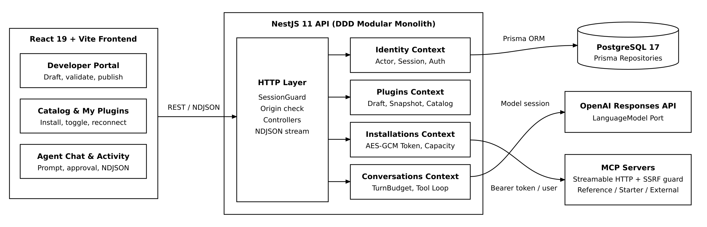
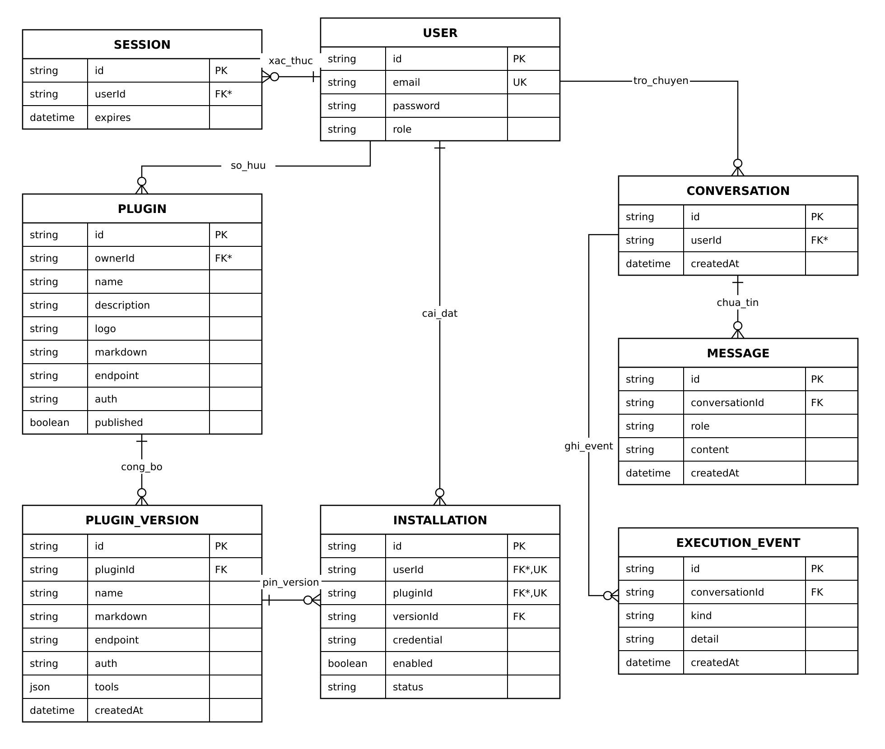
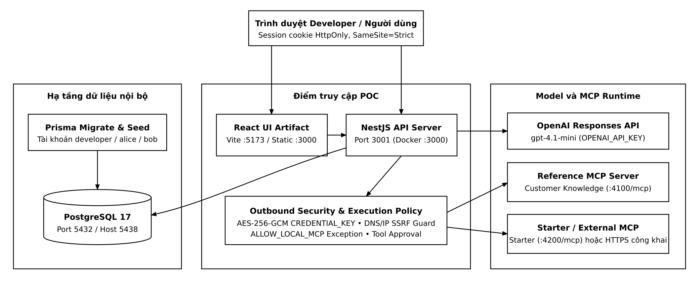
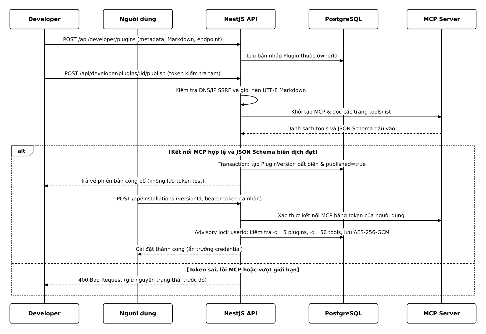
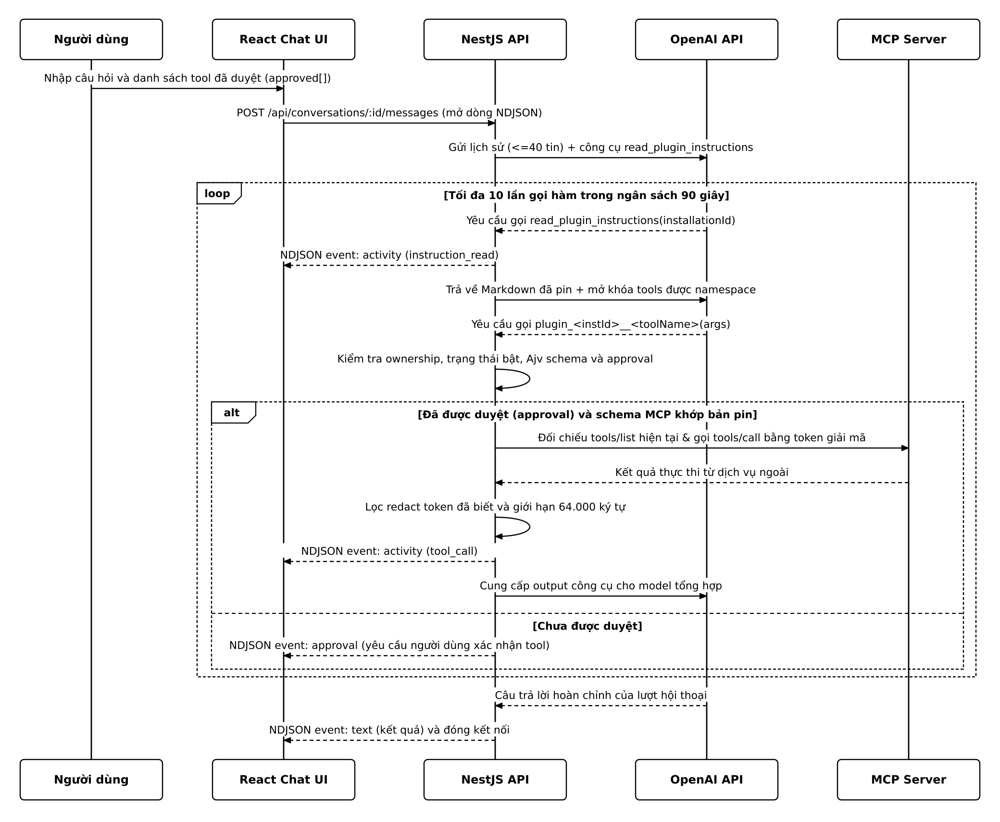

# BÁO CÁO PROOF OF CONCEPT

## HỆ THỐNG PLUGIN ĐA NGƯỜI DÙNG CHO AI AGENT

*Mô hình công bố, cài đặt theo người dùng và điều phối MCP plugin cho AI Agent*

## TÓM TẮT

Báo cáo trình bày kết quả xây dựng POC Plugin Lab cho phép developer công bố tích hợp dưới dạng plugin, người dùng cài đặt plugin bằng thông tin xác thực riêng và AI Agent sử dụng các công cụ được cấp để trả lời câu hỏi. Giải pháp gồm giao diện React 19 xây dựng bằng Vite 7, backend NestJS 11 tổ chức theo kiến trúc DDD modular monolith với bốn bounded context (Identity, Plugins, Installations và Conversations), cơ sở dữ liệu PostgreSQL 17 kết hợp Prisma ORM, tích hợp OpenAI Responses API qua cổng `LanguageModel` và kết nối công cụ ngoài qua giao thức Model Context Protocol (MCP) Streamable HTTP. Trọng tâm của POC là chứng minh tính khả thi của vòng đời plugin đa người dùng: đóng băng snapshot phiên bản công bố, mã hóa credential theo từng lượt cài đặt bằng AES-256-GCM, kiểm soát địa chỉ kết nối chống SSRF, nạp hướng dẫn theo cơ chế progressive disclosure qua `read_plugin_instructions` và kiểm tra quyền thực thi công cụ ở phía server.

Tại mốc mã nguồn được khảo sát, hệ thống đã hoàn thiện luồng end-to-end từ đăng ký bản nháp, xác thực MCP, công bố phiên bản bất biến, cài đặt theo tài khoản, hội thoại AI Agent có phê duyệt công cụ (tool approval), ghi nhận luồng sự kiện NDJSON đến bật, tắt, kết nối lại và gỡ cài đặt. Reference MCP Server (Customer Knowledge) chứng minh khả năng phân tách dữ liệu theo bearer token giữa hai tài khoản Alice và Bob; đồng thời gói `starters/mcp-plugin` cung cấp mẫu phát triển MCP server độc lập cho developer. Bộ kiểm tra tự động gồm kiểm tra kiểu TypeScript (`npm run check`), build hệ thống, 12 bài kiểm thử mặc định (domain, application, architecture, security), kiểm thử tích hợp HTTP (`INTEGRATION=true`), 4 kịch bản kiểm thử trình duyệt end-to-end bằng Playwright Chromium (`npm run test:browser`) và smoke test của starter đều đạt. Các hạng mục đánh giá với OpenAI thật ở quy mô tải thực tế, nâng cấp phiên bản tại chỗ và vận hành multi-instance được xác định là bước phát triển tiếp theo sau POC.

## DANH MỤC TỪ VIẾT TẮT

| Từ viết tắt | Tên tiếng Anh | Ý nghĩa tiếng Việt |
| --- | --- | --- |
| AES-GCM | Advanced Encryption Standard – Galois/Counter Mode | Chuẩn mã hóa đối xứng có xác thực dùng bảo vệ token cài đặt |
| AI | Artificial Intelligence | Trí tuệ nhân tạo hỗ trợ xử lý yêu cầu và chọn công cụ |
| API | Application Programming Interface | Giao diện lập trình ứng dụng |
| DDD | Domain-Driven Design | Thiết kế hướng miền nghiệp vụ với ranh giới trách nhiệm rõ ràng |
| LLM | Large Language Model | Mô hình ngôn ngữ lớn phục vụ hội thoại và suy luận công cụ |
| MCP | Model Context Protocol | Giao thức chuẩn hóa kết nối AI Agent với công cụ và dữ liệu ngoài |
| NDJSON | Newline-Delimited JSON | Định dạng truyền dòng sự kiện JSON phân tách theo dòng |
| ORM | Object–Relational Mapping | Kỹ thuật ánh xạ đối tượng – quan hệ do Prisma cung cấp |
| POC | Proof of Concept | Mô hình chứng minh tính khả thi kỹ thuật |
| SDK | Software Development Kit | Bộ công cụ phần mềm tích hợp MCP và OpenAI |
| SSRF | Server-Side Request Forgery | Lỗ hổng giả mạo yêu cầu phía máy chủ tới địa chỉ nội bộ |
| UI | User Interface | Giao diện người dùng |

*Bảng 0.1: Danh mục từ viết tắt sử dụng trong báo cáo.*

## MỤC LỤC

- [TÓM TẮT](#tóm-tắt)
- [DANH MỤC TỪ VIẾT TẮT](#danh-mục-từ-viết-tắt)
- [CHƯƠNG 1. TỔNG QUAN VỀ POC PLUGIN LAB](#chương-1-tổng-quan-về-poc-plugin-lab)
  - [1.1 Bối cảnh và bài toán](#11-bối-cảnh-và-bài-toán)
  - [1.2 Mục tiêu](#12-mục-tiêu)
  - [1.3 Phạm vi thực hiện](#13-phạm-vi-thực-hiện)
  - [1.4 Đối tượng sử dụng](#14-đối-tượng-sử-dụng)
  - [1.5 Kết luận chương](#15-kết-luận-chương)
- [CHƯƠNG 2. PHÂN TÍCH YÊU CẦU](#chương-2-phân-tích-yêu-cầu)
  - [2.1 Yêu cầu chức năng](#21-yêu-cầu-chức-năng)
  - [2.2 Yêu cầu phi chức năng](#22-yêu-cầu-phi-chức-năng)
  - [2.3 Các ràng buộc và giả định](#23-các-ràng-buộc-và-giả-định)
  - [2.4 Kết luận chương](#24-kết-luận-chương)
- [CHƯƠNG 3. THIẾT KẾ KIẾN TRÚC VÀ DỮ LIỆU](#chương-3-thiết-kế-kiến-trúc-và-dữ-liệu)
  - [3.1 Kiến trúc tổng thể](#31-kiến-trúc-tổng-thể)
  - [3.2 Công nghệ sử dụng](#32-công-nghệ-sử-dụng)
  - [3.3 Kiến trúc DDD và phân chia trách nhiệm backend](#33-kiến-trúc-ddd-và-phân-chia-trách-nhiệm-backend)
  - [3.4 Bảo mật credential, kiểm soát endpoint và nội dung plugin](#34-bảo-mật-credential-kiểm-soát-endpoint-và-nội-dung-plugin)
  - [3.5 Mô hình dữ liệu](#35-mô-hình-dữ-liệu)
  - [3.6 Mô hình triển khai POC](#36-mô-hình-triển-khai-poc)
  - [3.7 Kết luận chương](#37-kết-luận-chương)
- [CHƯƠNG 4. LUỒNG HOẠT ĐỘNG VÀ TRIỂN KHAI CHỨC NĂNG](#chương-4-luồng-hoạt-động-và-triển-khai-chức-năng)
  - [4.1 Hợp đồng đăng ký plugin và hướng dẫn Markdown](#41-hợp-đồng-đăng-ký-plugin-và-hướng-dẫn-markdown)
  - [4.2 Luồng kiểm tra, công bố và cài đặt plugin](#42-luồng-kiểm-tra-công-bố-và-cài-đặt-plugin)
  - [4.3 Luồng AI Agent đọc hướng dẫn và thực thi công cụ](#43-luồng-ai-agent-đọc-hướng-dẫn-và-thực-thi-công-cụ)
  - [4.4 Cơ chế phê duyệt, giới hạn vận hành và trải nghiệm lỗi](#44-cơ-chế-phê-duyệt-giới-hạn-vận-hành-và-trải-nghiệm-lỗi)
  - [4.5 Reference MCP Server và Developer Starter](#45-reference-mcp-server-và-developer-starter)
  - [4.6 API chính](#46-api-chính)
  - [4.7 Kết luận chương](#47-kết-luận-chương)
- [CHƯƠNG 5. KIỂM THỬ VÀ ĐÁNH GIÁ KẾT QUẢ](#chương-5-kiểm-thử-và-đánh-giá-kết-quả)
  - [5.1 Phương pháp kiểm thử](#51-phương-pháp-kiểm-thử)
  - [5.2 Kết quả quality gate](#52-kết-quả-quality-gate)
  - [5.3 Đối chiếu tiêu chí nghiệm thu](#53-đối-chiếu-tiêu-chí-nghiệm-thu)
  - [5.4 Ưu điểm](#54-ưu-điểm)
  - [5.5 Hạn chế và rủi ro](#55-hạn-chế-và-rủi-ro)
  - [5.6 Kết luận chương](#56-kết-luận-chương)
- [CHƯƠNG 6. HƯỚNG PHÁT TRIỂN VÀ KẾT LUẬN](#chương-6-hướng-phát-triển-và-kết-luận)
  - [6.1 Lộ trình đề xuất](#61-lộ-trình-đề-xuất)
  - [6.2 Kết luận](#62-kết-luận)
- [PHỤ LỤC A. HƯỚNG DẪN CHẠY NGẮN GỌN](#phụ-lục-a-hướng-dẫn-chạy-ngắn-gọn)
  - [A.1 Điều kiện và biến môi trường](#a1-điều-kiện-và-biến-môi-trường)
  - [A.2 Các lệnh chính](#a2-các-lệnh-chính)
  - [A.3 Địa chỉ phát triển và tài khoản demo](#a3-địa-chỉ-phát-triển-và-tài-khoản-demo)
- [TÀI LIỆU THAM KHẢO](#tài-liệu-tham-khảo)

## CHƯƠNG 1. TỔNG QUAN VỀ POC PLUGIN LAB

Chương này xác định bối cảnh nghiệp vụ, mục tiêu kỹ thuật, phạm vi triển khai và các nhóm đối tượng tham gia vào POC Plugin Lab. Việc chốt ranh giới ngay từ đầu giúp làm rõ những năng lực đã được chứng minh bằng mã nguồn và kiểm thử so với các hạng mục mở rộng thuộc giai đoạn sản phẩm hóa.

### 1.1 Bối cảnh và bài toán

Trong các hệ thống AI Agent hiện đại, nhu cầu kết nối mô hình ngôn ngữ với dữ liệu và dịch vụ nghiệp vụ của nhiều nhà cung cấp bên thứ ba ngày càng phổ biến. Nếu mỗi tích hợp được viết cứng vào mã nguồn của agent, việc thêm mới hoặc thay đổi một dịch vụ sẽ làm tăng độ kết dính giữa logic điều phối hội thoại, cơ chế xác thực và mã gọi API ngoài. Đồng thời, trong môi trường đa người dùng, hệ thống phải đảm bảo rằng cùng một plugin được công bố chung nhưng khi thực thi chỉ sử dụng đúng thông tin xác thực (credential) và phạm vi quyền hạn của người dùng đang thao tác.

POC (Proof of Concept) Plugin Lab giải quyết bài toán trên bằng cách tách biệt rõ ba vai trò: developer sở hữu mô tả tích hợp và vận hành MCP server bên ngoài; nền tảng sở hữu quy trình kiểm tra, đóng băng phiên bản công bố, quản lý cài đặt, bảo mật credential và điều phối lượt chạy của agent; người dùng cuối tự cung cấp bearer token cá nhân khi cài đặt. Tài liệu Markdown đính kèm theo plugin cung cấp ngữ cảnh hướng dẫn cho mô hình, trong khi các công cụ MCP đảm nhận giao tiếp thực tế với dịch vụ đích.

### 1.2 Mục tiêu

Mục tiêu cốt lõi của POC là tạo dựng một đường chạy end-to-end khép kín: developer đăng ký MCP endpoint kèm hướng dẫn Markdown, kiểm tra kết nối và công bố thành một phiên bản bất biến; người dùng khám phá plugin trên catalog, cài đặt bằng token riêng và trò chuyện với AI Agent. Trong mỗi lượt hội thoại, backend phải bắt buộc mô hình đọc hướng dẫn Markdown của bản cài đặt trước khi mở khóa các công cụ MCP tương ứng, kiểm tra phê duyệt (approval), đối chiếu schema công cụ hiện hành với phiên bản đã pin và truyền sự kiện hoạt động theo thời gian thực về giao diện.

Bên cạnh luồng tính năng, POC đặt mục tiêu xây dựng kiến trúc backend có tính bảo trì cao theo hướng Domain-Driven Design (DDD). Các quy tắc nghiệp vụ cốt lõi phải độc lập với NestJS, Prisma ORM, MCP SDK và OpenAI SDK, cho phép kiểm thử nhanh bằng unit test và hoán đổi hạ tầng qua các cổng giao tiếp (ports) rõ ràng.

### 1.3 Phạm vi thực hiện

| Nhóm | Nội dung |
| --- | --- |
| Trong phạm vi | Xác thực bằng session cookie với tài khoản seed; Developer Portal quản lý bản nháp (metadata, logo, UTF-8 Markdown, MCP endpoint, chế độ auth); kiểm tra kết nối MCP và khám phá công cụ có phân trang; công bố snapshot phiên bản bất biến; Catalog và cài đặt riêng theo user; mã hóa token AES-256-GCM; bật/tắt, kết nối lại và gỡ cài đặt; Agent Chat truyền dòng NDJSON và bảng sự kiện hoạt động; Reference MCP Server phân tách dữ liệu theo token; gói Developer Starter độc lập. |
| Ngoài phạm vi | Thực thi mã nguồn plugin tải lên nền tảng; luồng ủy quyền OAuth và tích hợp Composio; chia sẻ cài đặt ở cấp tổ chức (workspace/tenant sharing); nâng cấp phiên bản cài đặt tại chỗ; tích hợp năm kênh nhắn tin, hộp thư chung (shared inbox) hoặc widget nhúng; đăng ký tài khoản công khai, khôi phục mật khẩu và tính cước (billing). |
| Chưa xác minh cuối | Đánh giá chất lượng suy luận trên nhiều kịch bản với OpenAI API thật; kiểm thử chịu tải và vận hành nhiều API replica; tự động hóa toàn bộ hành trình trình duyệt (E2E browser automation). |

*Bảng 1.1: Phạm vi thực hiện của POC Plugin Lab.*

### 1.4 Đối tượng sử dụng

Developer là người phát triển MCP server, biên soạn hướng dẫn Markdown, kiểm tra hợp đồng công cụ trên Developer Portal và công bố phiên bản plugin lên catalog. Người dùng cuối (End User) là người duyệt catalog, cài đặt plugin với bearer token cá nhân, quản lý trạng thái bật/tắt và tương tác với AI Agent để khai thác dữ liệu từ dịch vụ ngoài. AI Agent đóng vai trò bộ điều phối suy luận trong từng lượt hội thoại, chỉ được phép đọc hướng dẫn và gọi công cụ nằm trong phạm vi bản cài đặt đang bật do backend cấp phát. Đội vận hành POC chịu trách nhiệm cấu hình cơ sở dữ liệu PostgreSQL, khóa mã hóa `CREDENTIAL_KEY`, khóa `OPENAI_API_KEY`, chính sách ngoại lệ local MCP và tiến trình dịch vụ.

### 1.5 Kết luận chương

POC Plugin Lab tập trung vào vòng đời tích hợp MCP đa người dùng và ranh giới phân quyền khi AI Agent gọi công cụ ngoài. Phạm vi được giới hạn hợp lý để chứng minh trọn vẹn tính đúng đắn của kiến trúc trước khi mở rộng sang quy mô sản phẩm hoàn chỉnh.

## CHƯƠNG 2. PHÂN TÍCH YÊU CẦU

Các yêu cầu của hệ thống được tổng hợp từ bài toán cổng tích hợp dành cho developer, tiêu chí phân tách dữ liệu đa người dùng và trạng thái mã nguồn hiện tại. Hệ thống yêu cầu được phân nhóm thành yêu cầu chức năng, yêu cầu phi chức năng và các ràng buộc kỹ thuật.

### 2.1 Yêu cầu chức năng

| Mã | Chức năng | Tiêu chí chính |
| --- | --- | --- |
| YC01 | Xác thực và phiên | Đăng nhập bằng tài khoản đã seed, kiểm tra mật khẩu băm scrypt, tạo session 24 giờ lưu cơ sở dữ liệu kèm cookie `HttpOnly`, `SameSite=Strict`. |
| YC02 | Quản lý bản nháp | Developer tạo và chỉnh sửa bản nháp plugin thuộc sở hữu của mình (tên, mô tả, logo tùy chọn, hướng dẫn Markdown, MCP endpoint, chế độ auth). |
| YC03 | Kiểm tra tích hợp | Backend kiểm tra quy tắc địa chỉ endpoint, khởi tạo phiên MCP Streamable HTTP, duyệt phân trang `tools/list` và biên dịch JSON Schema bằng Ajv. |
| YC04 | Công bố phiên bản | Kiểm tra lại kết nối từ snapshot bản nháp và lưu nguyên tử thành `PluginVersion` bất biến; chỉnh sửa bản nháp sau đó không làm thay đổi phiên bản đã công bố. |
| YC05 | Khám phá catalog | Hiển thị danh sách plugin cùng phiên bản công bố mới nhất, cho phép người dùng xem chi tiết hướng dẫn Markdown và danh sách công cụ trước khi cài đặt. |
| YC06 | Cài đặt theo user | Ràng buộc mỗi người dùng với một phiên bản plugin xác định, kiểm tra kết nối MCP bằng token của người dùng, mã hóa AES-256-GCM và kiểm soát giới hạn cài đặt. |
| YC07 | Quản lý cài đặt | Cho phép chủ sở hữu bật/tắt cài đặt, cập nhật token mới qua thao tác kết nối lại (reconnect) hoặc gỡ cài đặt để xóa hoàn toàn credential đã lưu. |
| YC08 | Đọc hướng dẫn | Trong lượt hội thoại, mô hình chỉ nhận công cụ nội bộ `read_plugin_instructions` lúc khởi đầu và phải đọc hướng dẫn của cài đặt hợp lệ trước khi nhận công cụ MCP. |
| YC09 | Thực thi công cụ | Kiểm tra quyền sở hữu, trạng thái bật, schema tham số đầu vào, yêu cầu phê duyệt (approval) và đối chiếu schema MCP hiện tại với bản đã pin trước khi gọi `tools/call`. |
| YC10 | Quan sát hoạt động | Lưu tin nhắn và sự kiện thực thi sau khi đã lọc bỏ token nhạy cảm; truyền dòng sự kiện NDJSON (`activity`, `approval`, `text`, `error`) về giao diện chat. |
| YC11 | Khởi tạo plugin mẫu | Cung cấp gói `starters/mcp-plugin` độc lập gồm MCP server xác thực bearer, công cụ mẫu, tài liệu hướng dẫn và bài kiểm thử hợp đồng SDK. |

*Bảng 2.1: Danh sách yêu cầu chức năng của POC.*

### 2.2 Yêu cầu phi chức năng

| Thuộc tính | Yêu cầu và cơ chế đáp ứng |
| --- | --- |
| Phân tách đa người dùng | Mọi thao tác trên bản nháp, bản cài đặt và hội thoại đều kiểm tra chủ sở hữu tại lớp domain/application; truy cập trái phép trả về lỗi 403 hoặc 404. |
| Bảo mật thông tin xác thực | Bearer token của từng bản cài đặt được mã hóa AES-256-GCM với khóa 32 byte từ môi trường; không trả về qua API, không đưa vào prompt và tự động lọc khỏi output. |
| Chống giả mạo kết nối (SSRF) | Yêu cầu HTTPS và địa chỉ IP công khai; phân giải và kiểm tra lại DNS ngay tại thời điểm mở kết nối; chặn loopback/private/link-local và tắt HTTP redirect. |
| Tính bất biến của phiên bản | Mỗi lần công bố tạo một bản ghi `PluginVersion` độc lập; bản cài đặt pin cứng vào `versionId` và từ chối thực thi nếu MCP server tự ý thay đổi schema. |
| Khả năng kiểm thử và bảo trì | Lớp domain và application hoàn toàn không phụ thuộc NestJS, Prisma hay SDK ngoài; hỗ trợ kiểm thử nhanh với fake adapter và kiểm tra kiến trúc tự động. |
| Giới hạn tài nguyên lượt chạy | Giới hạn tối đa 5 cài đặt bật và 50 công cụ trên mỗi người dùng; tối đa 10 lần gọi hàm và ngân sách 90 giây cho mỗi lượt hội thoại; timeout 15 giây mỗi yêu cầu MCP. |

*Bảng 2.2: Yêu cầu phi chức năng.*

### 2.3 Các ràng buộc và giả định

Giao thức kết nối giữa nền tảng và plugin là MCP Streamable HTTP với hai chế độ xác thực `none` hoặc `bearer`. Token dùng trong bước developer kiểm tra và công bố chỉ tồn tại tạm thời trong bộ nhớ của yêu cầu đó, tuyệt đối không được lưu làm thông tin xác thực dùng chung cho người dùng cuối. Mỗi tài khoản chỉ duy trì tối đa một bản cài đặt cho mỗi plugin (`@@unique([userId, pluginId])`); khi muốn chuyển sang phiên bản công bố mới, người dùng thực hiện gỡ và cài đặt lại.

Nội dung Markdown và mô tả công cụ do developer cung cấp được xem là dữ liệu không đáng tin cậy: giao diện hiển thị Markdown dưới dạng văn bản đã escape để ngăn thực thi mã HTML/script, còn backend giữ toàn quyền quyết định phân quyền và phê duyệt công cụ. Các lời gọi `tools/call` tới dịch vụ ngoài không tự động retry nhằm tránh gây lặp tác vụ có hiệu ứng phụ (side effects) khi xảy ra lỗi mạng. Ngoài ra, việc cô lập dữ liệu nghiệp vụ phía sau MCP endpoint phụ thuộc vào việc MCP server thực sự kiểm tra và phân tách workspace theo bearer token được truyền tới.

### 2.4 Kết luận chương

Tập yêu cầu của POC tập trung vào tính toàn vẹn của hợp đồng phiên bản, sự cô lập thông tin xác thực giữa các người dùng và cơ chế kiểm soát từng bước khi AI Agent gọi công cụ. Đây là nền tảng bắt buộc trước khi bổ sung các tiện ích quản trị nâng cao.

## CHƯƠNG 3. THIẾT KẾ KIẾN TRÚC VÀ DỮ LIỆU

Hệ thống được thiết kế theo mô hình modular monolith cho phần lõi nền tảng kết hợp với các tiến trình MCP server chạy độc lập. Cách tổ chức này vừa giữ cấu trúc triển khai gọn nhẹ cho POC, vừa phân định rõ ranh giới giao tiếp mạng thực tế giữa nền tảng điều phối, mô hình ngôn ngữ và dịch vụ plugin bên ngoài.

### 3.1 Kiến trúc tổng thể



*Hình 3.1: Kiến trúc tổng thể của POC Plugin Lab.*

Ứng dụng giao diện React 19 chỉ giao tiếp với NestJS API qua các endpoint REST và nhận dòng sự kiện hội thoại dưới dạng NDJSON, hoàn toàn không gọi trực tiếp tới OpenAI hay các MCP server. Backend NestJS đóng vai trò trung tâm kiểm soát bảo mật và điều phối: xác thực phiên người dùng qua `SessionGuard`, kiểm tra header `Origin` cho mọi yêu cầu thay đổi trạng thái, truy xuất bản cài đặt hợp lệ, giải mã bearer token trong bộ nhớ khi cần gọi công cụ và lọc dữ liệu nhạy cảm trước khi lưu trữ hoặc trả về client.

Trong môi trường phát triển, máy chủ Vite chạy tại cổng 5173 và chuyển tiếp (proxy) các yêu cầu `/api` sang NestJS tại cổng 3001. Trong bản đóng gói production của POC, NestJS trực tiếp phục vụ gói tài nguyên tĩnh của React cùng với REST API trên một origin duy nhất, giúp đơn giản hóa chính sách cookie và kiểm soát nguồn truy cập.

### 3.2 Công nghệ sử dụng

| Lớp | Công nghệ | Vai trò |
| --- | --- | --- |
| Runtime và ngôn ngữ | Node.js 24, TypeScript 5.8 | Môi trường thực thi phía server và kiểm tra kiểu tĩnh toàn dự án |
| Giao diện người dùng | React 19, Vite 7 | Giao diện Developer Portal, Catalog, My Plugins và Agent Chat |
| Backend khung ứng dụng | NestJS 11 (Express) | Quản lý dependency injection, controller, guard, exception filter và static hosting |
| Cơ sở dữ liệu và ORM | PostgreSQL 17, Prisma 6 | Lưu trữ quan hệ, quản lý migration, giao dịch và khóa tư vấn (advisory lock) |
| Mô hình ngôn ngữ | OpenAI SDK (Responses API) | Điều phối lượt hội thoại, chọn công cụ và tổng hợp câu trả lời |
| Giao thức công cụ ngoài | `@modelcontextprotocol/sdk` | Kết nối MCP Streamable HTTP, khám phá `tools/list` và gọi `tools/call` |
| Kiểm tra dữ liệu và mật mã | Zod, Ajv, Node `crypto` | Xác thực DTO, biên dịch JSON Schema công cụ và mã hóa AES-256-GCM |
| Kiểm thử và đóng gói | Node Test Runner (`tsx`), Docker Compose | Kiểm thử đơn vị/kiến trúc/tích hợp và đóng gói môi trường thực thi |

*Bảng 3.1: Công nghệ chính của hệ thống.*

### 3.3 Kiến trúc DDD và phân chia trách nhiệm backend

Backend được chia thành bốn bounded context độc lập cùng một thư mục kỹ thuật dùng chung (`backend/shared`). Mỗi context được tổ chức nghiêm ngặt thành bốn lớp: `domain` (thực thể, đối tượng giá trị, quy tắc bất biến), `application` (use case và cổng giao tiếp), `infrastructure` (adapter Prisma, OpenAI, MCP, chính sách bảo mật) và `http` (controller, DTO), được lắp ghép tại module NestJS đóng vai trò composition root.

| Bounded Context | Trách nhiệm miền nghiệp vụ | Bảng dữ liệu sở hữu |
| --- | --- | --- |
| `identity` | Quản lý danh tính `Actor`, phân quyền vai trò (`developer`, `user`), thời hạn phiên và xác thực đăng nhập. | `User`, `Session` |
| `plugins` | Kiểm tra quy tắc bản nháp, quyền sở hữu của nhà phát triển, đóng băng snapshot phiên bản công bố và cung cấp catalog. | `Plugin`, `PluginVersion` |
| `installations` | Quản lý cài đặt theo người dùng, ghim phiên bản (`versionId`), bảo vệ credential, kiểm soát hạn ngạch (5 plugin / 50 tool) và thực thi MCP. | `Installation` |
| `conversations` | Quản lý quyền sở hữu hội thoại, kiểm tra độ dài prompt, giới hạn ngân sách lượt chạy (`TurnBudget`) và lưu trữ lịch sử/hoạt động. | `Conversation`, `Message`, `ExecutionEvent` |
| `shared` | Định nghĩa lỗi miền cơ sở, cổng kỹ thuật (`Clock`, `Ids`, `SecretBox`, `ToolGateway`), kết nối Prisma, bảo mật SSRF và bộ lọc HTTP. | Không sở hữu bảng riêng |

*Bảng 3.2: Phân chia trách nhiệm các bounded context.*

Chiều phụ thuộc trong toàn bộ mã nguồn tuân theo quy tắc hướng vào trong: lớp `http` gọi `application`; lớp `application` phối hợp các đối tượng `domain` và giao tiếp ra ngoài thông qua interface; lớp `infrastructure` triển khai các interface đó. Các bài kiểm thử kiến trúc tự động (`tests/architecture.test.ts`) đảm bảo lớp `domain` và `application` không chứa bất kỳ lệnh import nào tới NestJS, Prisma, Express hay SDK nhà cung cấp, đồng thời ngăn controller truy cập trực tiếp vào tầng lưu trữ.

Giao tiếp liên ngữ cảnh (cross-context communication) chỉ diễn ra qua các hợp đồng ứng dụng đã xuất khẩu: context `installations` đọc thông tin phiên bản đã công bố thông qua cổng `PublishedPlugins` do `plugins` cung cấp thay vì truy vấn trực tiếp bảng `PluginVersion`; context `conversations` liệt kê năng lực, tải hướng dẫn và gọi công cụ thông qua cổng `InstalledPlugins` do `installations` cung cấp mà không bao giờ nhìn thấy chuỗi credential hay client MCP bên dưới.

### 3.4 Bảo mật credential, kiểm soát endpoint và nội dung plugin

Thông tin xác thực của từng bản cài đặt được bảo vệ bởi adapter `AesGcmSecretBox` sử dụng thuật toán AES-256-GCM với khóa 32 byte đọc từ biến môi trường `CREDENTIAL_KEY`. Mỗi lần mã hóa sinh một vector khởi tạo (IV) ngẫu nhiên 12 byte và thẻ xác thực (auth tag) 16 byte, giúp phát hiện mọi hành vi can thiệp vào bản mã trong cơ sở dữ liệu. Đối tượng miền `Installation` tách biệt phương thức xuất dữ liệu công khai (không có credential) với phương thức lấy token phục vụ thực thi nội bộ.

Để phòng chống tấn công SSRF khi developer đăng ký MCP URL tùy ý, mô-đun `backend/shared/infrastructure/security.ts` áp dụng bộ quy tắc kiểm tra đa tầng: bắt buộc giao thức HTTPS (trừ ngoại lệ local khớp chính xác với `REFERENCE_MCP_URL` khi `ALLOW_LOCAL_MCP=true`), từ chối URL chứa thông tin đăng nhập nhúng, phân giải toàn bộ bản ghi DNS A/AAAA và chặn các dải địa chỉ loopback, private, link-local, carrier-grade NAT hoặc địa chỉ IPv6 ánh xạ IPv4 nội bộ. Đặc biệt, một custom lookup hook được gắn trực tiếp vào agent kết nối HTTP để kiểm tra lại địa chỉ IP ngay tại thời điểm mở socket (chống tấn công DNS rebinding), đồng thời cấu hình `redirect: 'error'` để chặn mọi phản hồi chuyển hướng.

### 3.5 Mô hình dữ liệu



*Hình 3.2: Mô hình dữ liệu của POC Plugin Lab.*

Lược đồ cơ sở dữ liệu gồm tám thực thể chính phản ánh bốn bounded context. Bảng `User` và `Session` phục vụ nhận diện tác nhân; bảng `Plugin` lưu trạng thái bản nháp hiện tại của developer, trong khi bảng `PluginVersion` lưu trữ các bản chụp bất biến gồm metadata, nội dung Markdown và mảng định nghĩa công cụ dưới dạng JSON mỗi khi công bố. Bảng `Installation` liên kết người dùng với một `PluginVersion` cụ thể, lưu bản mã `credential` và áp đặt ràng buộc duy nhất `@@unique([userId, pluginId])`. Bảng `Conversation` cùng hai bảng con `Message` và `ExecutionEvent` lưu trữ lịch sử trao đổi và nhật ký hoạt động đã được lọc bỏ token.

Các thao tác thay đổi trạng thái quan trọng được bảo vệ bằng giao dịch cơ sở dữ liệu: quá trình công bố chèn bản ghi `PluginVersion` mới và bật cờ `published` của `Plugin` trong cùng một transaction; các thao tác cài đặt mới, bật/tắt, kết nối lại và gỡ cài đặt đều sử dụng khóa tư vấn PostgreSQL (`pg_advisory_xact_lock`) phân vùng theo `userId`, ngăn chặn các yêu cầu đồng thời vượt quá hạn ngạch 5 plugin hoặc 50 công cụ đang bật của một người dùng.

### 3.6 Mô hình triển khai POC



*Hình 3.3: Mô hình triển khai và handoff của POC Plugin Lab.*

Gói Docker Compose của dự án định nghĩa ba dịch vụ cốt lõi: cơ sở dữ liệu `db` (PostgreSQL 17 với persistent volume), dịch vụ `reference` chạy Reference MCP Server tại địa chỉ nội bộ `http://reference:4100/mcp` và dịch vụ `web` chạy ứng dụng NestJS kèm giao diện React đã build tại cổng `3000` (tự động thực thi `prisma migrate deploy` và seed tài khoản mẫu khi khởi động). Khi phát triển trực tiếp trên máy chủ host, developer có thể chạy riêng PostgreSQL, khởi động Reference MCP Server hoặc Starter MCP Server (`http://localhost:4200/mcp`) và chạy đồng thời Vite cùng NestJS qua lệnh `npm run dev`.

### 3.7 Kết luận chương

Kiến trúc DDD modular monolith kết hợp cơ chế đóng băng phiên bản và cổng giao tiếp liên ngữ cảnh giúp hệ thống tách biệt hoàn toàn logic điều phối nghiệp vụ khỏi chi tiết lưu trữ Prisma, giao thức MCP và nhà cung cấp mô hình OpenAI.

## CHƯƠNG 4. LUỒNG HOẠT ĐỘNG VÀ TRIỂN KHAI CHỨC NĂNG

Chương này trình bày chi tiết hợp đồng tích hợp plugin và hai luồng hoạt động quan trọng nhất của hệ thống: quy trình kiểm tra – công bố – cài đặt plugin theo người dùng và quy trình AI Agent đọc hướng dẫn Markdown để gọi công cụ MCP trong hội thoại.

### 4.1 Hợp đồng đăng ký plugin và hướng dẫn Markdown

*Đoạn mã 4.1: Cấu trúc metadata đăng ký plugin mẫu (`starters/mcp-plugin/plugin.example.json`).*

```json
{
  "name": "Project Status Starter",
  "description": "Look up workspace-scoped project delivery status from the starter MCP server.",
  "endpoint": "http://localhost:4200/mcp",
  "auth": "bearer",
  "instructionsFile": "instructions.md",
  "sampleValidationToken": "acme-demo-token"
}
```

Mỗi plugin trong Plugin Lab được định nghĩa bởi tập thông tin gồm tên (1–100 ký tự), mô tả (1–1.000 ký tự), ảnh logo tùy chọn dưới dạng Data URL (PNG, JPEG hoặc WebP, tối đa 2 MB), tài liệu hướng dẫn Markdown mã hóa UTF-8 (tối đa 64 KB), địa chỉ MCP endpoint và chế độ xác thực (`none` hoặc `bearer`). Nền tảng không nhận hay thực thi bất kỳ tệp mã nguồn nào từ developer; toàn bộ logic xử lý nghiệp vụ nằm tại MCP server độc lập và chỉ giao tiếp với nền tảng qua giao thức chuẩn.

### 4.2 Luồng kiểm tra, công bố và cài đặt plugin



*Hình 4.1: Trình tự kiểm tra, công bố và cài đặt plugin theo người dùng.*

Khi developer chọn kiểm tra (Validate) hoặc công bố (Publish) một bản nháp, hệ thống trước tiên chụp lại trạng thái bản nháp tại thời điểm bắt đầu yêu cầu để đảm bảo các chỉnh sửa đồng thời trong lúc đang chờ mạng không làm sai lệch dữ liệu được công bố. Tiếp theo, `McpToolGateway` kiểm tra quy tắc bảo mật URL/DNS, khởi tạo client MCP Streamable HTTP với thời gian chờ 15 giây và giới hạn phản hồi 1 MB, sau đó lặp qua tối đa 10 trang `tools/list` để thu thập từ 1 đến 50 công cụ không trùng tên. Mỗi công cụ phải có `inputSchema` kiểu `object` biên dịch thành công qua Ajv. Nếu công bố thành công, một bản ghi `PluginVersion` bất biến được tạo trong cơ sở dữ liệu và xuất hiện trên Catalog; token dùng để kiểm tra chỉ tồn tại trong bộ nhớ của yêu cầu và bị hủy ngay sau đó.

Khi người dùng cuối cài đặt plugin từ Catalog, backend tải `PluginVersion` tương ứng, yêu cầu người dùng cung cấp bearer token cá nhân (nếu plugin cấu hình `auth = "bearer"`) và thực hiện kết nối thử tới MCP endpoint để xác nhận token hợp lệ. Sau khi xác thực thành công, hệ thống lấy khóa tư vấn theo `userId`, kiểm tra người dùng chưa cài trùng plugin đó và tổng số cài đặt đang bật không vượt quá 5 plugin hoặc 50 công cụ, rồi mới mã hóa token bằng AES-256-GCM và lưu bản ghi `Installation` ghim cứng vào `versionId` đã chọn.

### 4.3 Luồng AI Agent đọc hướng dẫn và thực thi công cụ



*Hình 4.2: Trình tự hội thoại AI Agent đọc hướng dẫn và thực thi công cụ MCP.*

Mỗi lượt chat (`POST /api/conversations/:id/messages`) áp dụng cơ chế mở khóa công cụ theo từng bước (progressive disclosure) nhằm tiết kiệm ngữ cảnh prompt và bắt buộc mô hình tuân thủ hướng dẫn của developer:

1. **Khởi tạo lượt chạy:** Backend xác minh quyền sở hữu cuộc hội thoại, nạp tối đa 40 tin nhắn gần nhất cùng danh sách các bản cài đặt đang bật của người dùng (chỉ gồm `installationId`, tên và mô tả). Ở vòng gọi mô hình đầu tiên, mô hình chỉ được cung cấp duy nhất một công cụ nội bộ là `read_plugin_instructions`.
2. **Đọc hướng dẫn Markdown:** Khi mô hình gọi `read_plugin_instructions(installationId)`, backend kiểm tra lại quyền sở hữu và trạng thái đang bật của bản cài đặt, trả về nội dung Markdown của `PluginVersion` đã pin, ghi nhận sự kiện `instruction_read` vào dòng NDJSON và mở khóa các công cụ của bản cài đặt đó cho vòng suy luận tiếp theo dưới tên đã được phân vùng không gian tên `plugin_<installationId>__<toolName>`.
3. **Kiểm tra phê duyệt và chống trôi lược đồ (schema drift):** Khi mô hình yêu cầu gọi một công cụ đã mở khóa, backend xác thực tham số đầu vào bằng Ajv theo schema đã pin và kiểm tra chính sách phê duyệt. Nếu công cụ chưa được phê duyệt, backend phát sự kiện `approval` qua dòng NDJSON và dừng lượt chạy để chờ người dùng xác nhận. Nếu đã được phép, backend gọi lại `tools/list` tới MCP server để đối chiếu schema thực tế hiện hành với schema của phiên bản đã pin, đồng thời kiểm tra lại bản cài đặt không bị tắt hoặc gỡ trong thời gian chờ mạng.
4. **Thực thi, lọc dữ liệu và tổng hợp câu trả lời:** Backend giải mã bearer token của người dùng để gọi `tools/call`, sau đó đi qua bộ lọc `sanitize` nhằm thay thế mọi chuỗi token đã biết bằng `[redacted]` và cắt giới hạn kết quả ở 64.000 ký tự trước khi lưu `ExecutionEvent`, phát sự kiện `activity` về UI và chuyển kết quả lại cho mô hình sinh câu trả lời cuối cùng.

### 4.4 Cơ chế phê duyệt, giới hạn vận hành và trải nghiệm lỗi

Để tránh việc mô hình tự ý kích hoạt các thao tác nhạy cảm trên dịch vụ bên ngoài, hệ thống mặc định yêu cầu người dùng đánh dấu phê duyệt theo tên công cụ cho lượt hội thoại tiếp theo. Chỉ hai công cụ tra cứu thuộc Reference MCP Server (`search_articles` và `get_article`) là được cấu hình tin cậy tự động khi chạy với ngoại lệ local demo; cờ `readOnlyHint` do một MCP server bất kỳ tự khai báo không được dùng để bỏ qua bước phê duyệt của nền tảng.

| Hạng mục hoặc tình huống | Giới hạn và hành vi xử lý của hệ thống |
| --- | --- |
| Kích thước dữ liệu plugin | Tên 1–100 ký tự; mô tả 1–1.000 ký tự; Markdown tối đa 65.536 byte UTF-8; logo PNG/JPEG/WebP tối đa 2.097.152 byte; 1–50 công cụ/phiên bản. |
| Hạn ngạch theo người dùng | Tối đa 5 bản cài đặt đang bật và tổng cộng tối đa 50 công cụ đang bật trên mỗi tài khoản người dùng. |
| Ngân sách một lượt hội thoại | Prompt 1–8.000 ký tự; tối đa 10 lần gọi hàm (gồm cả đọc hướng dẫn); thời gian điều phối tối đa 90 giây; mỗi yêu cầu HTTP tới MCP tối đa 15 giây và 1 MB. |
| Truy cập tài nguyên trái phép | Trả về `401` khi chưa đăng nhập, `403` khi tài khoản `user` gọi API developer, `404` khi truy cập bản nháp, cài đặt hoặc hội thoại của người khác, `409` khi cài trùng. |
| Trôi lược đồ (Schema drift) | Nếu công cụ trên MCP server bị xóa hoặc thay đổi định nghĩa so với `PluginVersion` đã pin, từ chối thực thi để bảo vệ tính nhất quán của bản cài đặt. |
| Lỗi công cụ hoặc hết ngân sách | Lỗi thực thi công cụ được ghi nhận vào sự kiện `tool_error` và trả cho mô hình xử lý; lỗi mô hình hoặc quá thời gian phát sự kiện `error` trên dòng NDJSON. |

*Bảng 4.1: Giới hạn vận hành và xử lý lỗi trong POC.*

### 4.5 Reference MCP Server và Developer Starter

Hệ thống đi kèm hai cài đặt MCP server phục vụ hai mục đích bổ trợ nhau. Thứ nhất, `reference/server.ts` là máy chủ Customer Knowledge dùng trong kịch bản demo chính, cung cấp hai công cụ `search_articles` và `get_article`. Máy chủ này ánh xạ trực tiếp bearer token tới kho tri thức riêng biệt: token `alice-demo-token` chỉ truy cập được các bài viết của Alice (ví dụ chính sách hoàn tiền 14 ngày tại `alice-refund`), trong khi `bob-demo-token` chỉ truy cập được kho dữ liệu của Bob (chính sách hoàn tiền 30 ngày tại `bob-refund`), qua đó chứng minh rõ ràng tính cô lập dữ liệu theo thông tin xác thực của từng người dùng trên cùng một plugin.

Thứ hai, thư mục `starters/mcp-plugin/` là gói khởi tạo độc lập có `package.json`, cấu hình TypeScript, tài liệu hướng dẫn và bộ kiểm thử riêng. Developer có thể sao chép trực tiếp thư mục này để phát triển một plugin mới (mặc định minh họa công cụ `get_project_status` trên cổng 4200) mà không phụ thuộc vào mã nguồn backend hay cơ sở dữ liệu của nền tảng.

### 4.6 API chính

| Phương thức | Đường dẫn | Chức năng | Bảo vệ |
| --- | --- | --- | --- |
| `POST` | `/api/login` | Xác thực email/mật khẩu và cấp cookie phiên | Public + kiểm tra Origin |
| `POST`, `GET` | `/api/logout`, `/api/me` | Đăng xuất xóa phiên; truy vấn thông tin actor hiện tại | Session cookie |
| `GET`, `POST` | `/api/developer/plugins` | Liệt kê bản nháp sở hữu; tạo bản nháp plugin mới | Session + vai trò `developer` |
| `PATCH` | `/api/developer/plugins/:id` | Cập nhật thông tin bản nháp plugin thuộc quyền sở hữu | Session + chủ sở hữu bản nháp |
| `POST` | `/api/developer/plugins/:id/validate` | Kiểm tra kết nối MCP và khám phá danh sách công cụ | Session + chủ sở hữu bản nháp |
| `POST` | `/api/developer/plugins/:id/publish` | Xác thực lại và đóng băng thành `PluginVersion` mới | Session + chủ sở hữu bản nháp |
| `GET` | `/api/catalog` | Liệt kê phiên bản công bố mới nhất của từng plugin | Session cookie |
| `GET`, `POST` | `/api/installations` | Xem danh sách đã cài; cài đặt một `PluginVersion` bằng token riêng | Session cookie + khóa tư vấn |
| `PATCH`, `DELETE` | `/api/installations/:id` | Bật/tắt, cập nhật token (reconnect) hoặc gỡ cài đặt | Session + chủ sở hữu cài đặt |
| `GET`, `POST` | `/api/conversations` | Liệt kê danh sách hội thoại; tạo cuộc hội thoại mới | Session cookie |
| `GET` | `/api/conversations/:id` | Đọc lịch sử tin nhắn và nhật ký hoạt động của hội thoại | Session + chủ sở hữu hội thoại |
| `POST` | `/api/conversations/:id/messages` | Thực thi một lượt AI Agent và truyền dòng sự kiện NDJSON | Session + chủ sở hữu hội thoại |

*Bảng 4.2: Các endpoint chính của POC.*

### 4.7 Kết luận chương

Các luồng nghiệp vụ đã kết nối chặt chẽ từ khâu đăng ký hợp đồng MCP của developer tới khâu thực thi công cụ có kiểm soát trong hội thoại của người dùng. Mọi quyết định ủy quyền, giải mã token và kiểm tra lược đồ đều được thực hiện tập trung tại backend.

## CHƯƠNG 5. KIỂM THỬ VÀ ĐÁNH GIÁ KẾT QUẢ

Việc đánh giá hệ thống dựa trên bộ kiểm thử tự động đa tầng, kiểm tra kiểu tĩnh, kết quả đóng gói build sản phẩm và đối chiếu trực tiếp với các tiêu chí nghiệm thu của hạng mục POC Plugin Lab.

### 5.1 Phương pháp kiểm thử

Chiến lược kiểm thử được phân tầng theo đúng cấu trúc kiến trúc DDD:

- **Kiểm thử miền nghiệp vụ (`tests/domain.test.ts`):** Chạy hoàn toàn trong bộ nhớ không cần framework hay cơ sở dữ liệu, xác minh tính độc lập của snapshot khi công bố, giới hạn độ dài Markdown theo byte UTF-8, quyền sở hữu, hạn ngạch 5 plugin / 50 công cụ, thời hạn phiên và ngân sách lượt chạy `TurnBudget`.
- **Kiểm thử tầng ứng dụng (`tests/application.test.ts`):** Sử dụng fake repository và fake gateway để kiểm chứng luồng yêu cầu phê duyệt công cụ, sử dụng đúng credential theo bản cài đặt, chặn thực thi khi phát hiện schema drift và thu hồi quyền ngay khi bản cài đặt bị tắt trong lúc đang khám phá công cụ.
- **Kiểm thử ranh giới kiến trúc (`tests/architecture.test.ts`):** Phân tích mã nguồn tĩnh nhằm đảm bảo tầng `domain` và `application` không import module hạ tầng, đồng thời tầng `http` không truy cập trực tiếp Prisma hoặc SDK ngoài.
- **Kiểm thử bảo mật (`tests/security.test.ts`):** Kiểm증 tính toàn vẹn của bản mã AES-256-GCM, quy tắc chặn các dải IP nội bộ/loopback/link-local/mapped IPv6 chống SSRF, kiểm soát ngoại lệ local chính xác và cơ chế lọc bỏ token nhạy cảm khỏi output.
- **Kiểm thử tích hợp HTTP (`tests/api.test.ts`):** Khởi chạy đồng thời máy chủ NestJS thật, PostgreSQL, Reference MCP Server và máy chủ OpenAI giả lập để kiểm tra toàn bộ hành trình từ đăng nhập, kiểm tra lỗi token sai, công bố, sửa bản nháp không ảnh hưởng bản đã công bố, phân tách dữ liệu giữa Alice và Bob, đọc hướng dẫn trước khi gọi công cụ đến tắt và gỡ cài đặt.
- **Kiểm thử trình duyệt E2E bằng Playwright (`tests/browser/walkthrough.spec.ts`):** Khởi chạy bản build production trên Chromium kết nối NestJS thật, schema PostgreSQL cô lập (`E2E_DATABASE_URL`), Reference MCP Server và mock OpenAI để xác minh 4 kịch bản: toàn bộ vòng đời công bố – cài đặt – cô lập Alice/Bob – hội thoại – reconnect – bật/tắt/gỡ plugin, xóa sạch trạng thái bản nháp khi đăng xuất chuyển tài khoản, bố cục responsive trên khung nhìn di động 390×844 và giữ nguyên nội dung câu hỏi khi xảy ra lỗi kết nối.
- **Kiểm thử gói Starter (`starters/mcp-plugin/tests/plugin.test.ts`):** Khởi chạy starter server trên cổng tạm và dùng MCP Client SDK chính thức kiểm tra xác thực bearer, khám phá công cụ, phân tách workspace theo token và xử lý lỗi tham số.

### 5.2 Kết quả quality gate

| Hạng mục | Kết quả | Bằng chứng xác minh |
| --- | --- | --- |
| Kiểm tra kiểu tĩnh (`npm run check`) | Đạt | `tsc --noEmit` và `tsc -p tsconfig.server.json --noEmit` hoàn tất không lỗi. |
| Kiểm thử mặc định (`npm test`) | Đạt | 12 bài kiểm thử đơn vị, ứng dụng, kiến trúc và bảo mật đạt; 2 bài kiểm thử mạng opt-in bỏ qua theo cấu hình mặc định. |
| Kiểm thử tích hợp (`INTEGRATION=true npm test`) | Đạt | 13 bài kiểm thử đạt (bao gồm toàn bộ luồng HTTP + PostgreSQL + Reference MCP + Mock OpenAI), 1 bài kiểm thử rời bỏ qua. |
| Kiểm thử trình duyệt (`npm run test:browser`) | Đạt | 4 kịch bản Playwright Chromium đạt (desktop 1440×1000 và mobile 390×844), không có lỗi console hoặc HTTP 5xx. |
| Build hệ thống (`npm run build`) | Đạt | Prisma client generate, biên dịch NestJS (`dist/backend`) và đóng gói Vite React (`dist/frontend`) thành công. |
| Build và test gói Starter | Đạt | `npm --prefix starters/mcp-plugin run build` và `test` đạt trọn vẹn bài smoke test SDK. |

*Bảng 5.1: Kết quả kiểm tra tự động ngày 24/11/2026.*

### 5.3 Đối chiếu tiêu chí nghiệm thu

| Tiêu chí nghiệm thu | Trạng thái | Nhận xét và bằng chứng |
| --- | --- | --- |
| Developer đăng ký và công bố MCP plugin | Đạt | Kiểm tra kết nối, từ chối token/schema không hợp lệ và tạo bản ghi `PluginVersion` bất biến. |
| Phiên bản công bố độc lập với chỉnh sửa bản nháp | Đạt | Sửa bản nháp sau khi công bố không làm thay đổi dữ liệu trên Catalog hoặc bản cài đặt đang chạy. |
| Cài đặt riêng và cô lập credential theo người dùng | Đạt | Token được mã hóa AES-256-GCM, ẩn khỏi API; Alice và Bob nhận kết quả hoàn toàn tách biệt theo token riêng. |
| Bảo vệ quyền sở hữu tài nguyên giữa các tài khoản | Đạt | Mọi truy cập chéo tài khoản vào bản nháp, bản cài đặt hoặc hội thoại đều bị chặn với mã lỗi 403/404. |
| AI Agent đọc hướng dẫn trước khi gọi công cụ | Đạt | Công cụ MCP chỉ được cung cấp cho mô hình sau khi `read_plugin_instructions` thực thi thành công. |
| Kiểm soát phê duyệt, schema drift và thu hồi quyền | Đạt | Chặn gọi công cụ khi chưa được duyệt, khi MCP schema thay đổi hoặc khi bản cài đặt vừa bị tắt/gỡ. |
| Bật, tắt, kết nối lại và gỡ cài đặt | Đạt | Tắt hoặc gỡ cài đặt ngăn chặn ngay lập tức các lượt đọc hướng dẫn và gọi công cụ mới. |
| Cung cấp bộ khung khởi tạo cho developer | Đạt | Gói `starters/mcp-plugin` biên dịch và vượt qua bài kiểm thử hợp đồng MCP độc lập. |
| Đánh giá hội thoại thực tế với OpenAI thật | Chưa xác nhận cuối | Cần cấu hình `OPENAI_API_KEY` thật và nghiệm thu chất lượng câu trả lời trên tập kịch bản đa dạng. |

*Bảng 5.2: Ma trận đối chiếu tiêu chí nghiệm thu.*

### 5.4 Ưu điểm

Ưu điểm nổi bật của hệ thống là sự phân tách ranh giới bảo mật và trách nhiệm nghiệp vụ rất rõ ràng: developer không cần can thiệp vào mã nguồn nền tảng, thông tin xác thực không bao giờ bị dùng chung giữa người công bố và người cài đặt, còn AI Agent luôn bị đặt dưới lớp kiểm soát ủy quyền của backend. Kiến trúc DDD modular monolith với các cổng giao tiếp `PublishedPlugins`, `InstalledPlugins` và `LanguageModel` giúp các quy tắc cốt lõi được kiểm chứng hoàn toàn bằng kiểm thử tự động tốc độ cao mà không bị ràng buộc chặt vào ORM hay SDK bên thứ ba.

### 5.5 Hạn chế và rủi ro

| Nhóm | Hạn chế và rủi ro hiện tại |
| --- | --- |
| Xác thực và tài khoản | Sử dụng tài khoản seed phục vụ demo; chưa có giới hạn tần suất đăng nhập (login rate limit), đăng ký hay khôi phục mật khẩu. |
| Cơ chế phê duyệt công cụ | Phê duyệt hiện áp dụng theo tên công cụ trong phạm vi một lượt chat, chưa ràng buộc với tập giá trị tham số cụ thể (argument-bound approval). |
| Điều phối hội thoại đồng thời | Chưa khóa tuần tự các lượt gửi tin đồng thời trên cùng một hội thoại và chưa có idempotency key cho yêu cầu chạy agent. |
| Quản lý vòng đời phiên bản | Người dùng nâng cấp phiên bản bằng cách gỡ và cài lại; chưa có chức năng nâng cấp/quay lui (upgrade/rollback) tại chỗ hoặc thu hồi phiên bản lỗi. |
| Quản lý khóa và dữ liệu nhạy cảm | Sử dụng một khóa `CREDENTIAL_KEY` tĩnh từ biến môi trường, chưa có cơ chế xoay vòng khóa (key rotation) hoặc bộ lọc dữ liệu cá nhân (PII) tổng quát. |
| Phụ thuộc và vận hành | Chuỗi phụ thuộc CLI của Prisma 6 còn cảnh báo audit ở gói chuyển tiếp; hệ thống chưa bao gồm giám sát sức khỏe định kỳ, tracing phân tán và cấu hình HA. |

*Bảng 5.3: Hạn chế và rủi ro hiện tại của POC.*

### 5.6 Kết luận chương

Các bằng chứng kiểm thử ở cả tầng miền nghiệp vụ, tầng ứng dụng, ranh giới kiến trúc và tích hợp HTTP đã xác nhận tính đúng đắn của luồng công bố, cài đặt và điều phối MCP plugin. Để tiến lên môi trường production, hệ thống cần tiếp tục giai đoạn nghiệm thu với mô hình thật và bổ sung các lớp bảo vệ vận hành.

## CHƯƠNG 6. HƯỚNG PHÁT TRIỂN VÀ KẾT LUẬN

Việc chuyển giao từ mô hình POC sang sản phẩm thực tế cần ưu tiên hoàn tất nghiệm thu với dịch vụ LLM thật và tăng cường độ tin cậy của luồng thực thi công cụ trước khi mở rộng thêm các tính năng quản trị tổ chức hay đa kênh. Lộ trình dưới đây giữ nguyên nền tảng kiến trúc DDD hiện có và nâng cấp dần các adapter hạ tầng.

### 6.1 Lộ trình đề xuất

| Ưu tiên | Nhóm việc | Nội dung triển khai |
| --- | --- | --- |
| 1 | Nghiệm thu mô hình thật | Thực hiện bộ kịch bản kiểm thử end-to-end với OpenAI Responses API thật, đánh giá chất lượng tuân thủ Markdown và hoàn thiện kiểm thử giao diện tự động. |
| 2 | Siết chặt thực thi công cụ | Nâng cấp cơ chế phê duyệt gắn liền với tham số gọi hàm (argument-specific approval), bổ sung khóa tuần tự theo hội thoại và idempotency key cho lượt chat. |
| 3 | Bảo mật và quản lý khóa | Bổ sung rate limit cho đăng nhập và API chat, tích hợp secret manager với cơ chế xoay vòng `CREDENTIAL_KEY`, nâng cấp Prisma và quy trình duyệt nhà phát triển. |
| 4 | Vòng đời phiên bản plugin | Hỗ trợ nâng cấp/quay lui phiên bản cài đặt mà không cần nhập lại credential, kiểm tra tương thích schema và cho phép developer thu hồi phiên bản lỗi. |
| 5 | Quan sát và vận hành | Tích hợp hệ thống thu thập metric, structured logging, distributed tracing, kiểm tra sức khỏe MCP endpoint định kỳ, chính sách lưu trữ (retention) và sao lưu. |
| 6 | Mở rộng năng lực sản phẩm | Bổ sung chia sẻ cài đặt ở cấp tổ chức (workspace/tenant), cấu hình nhiều AI Agent chuyên biệt, hỗ trợ luồng OAuth 2.0 và kết nối với hệ thống đa kênh/inbox. |

*Bảng 6.1: Lộ trình phát triển sau POC.*

### 6.2 Kết luận

POC Plugin Lab đã hoàn thành mục tiêu chứng minh khả năng xây dựng một nền tảng plugin đa người dùng dựa trên giao thức chuẩn Model Context Protocol. Hệ thống giải quyết trọn vẹn bài toán tách biệt giữa người công bố tích hợp và người cài đặt sử dụng, bảo vệ thông tin xác thực bằng mã hóa AES-256-GCM, kiểm soát kết nối mạng chống SSRF và dẫn dắt AI Agent hoạt động an toàn theo cơ chế đọc hướng dẫn Markdown trước khi mở khóa công cụ.

Kết quả hiện tại đáp ứng tốt mục tiêu demo kỹ thuật, đánh giá kiến trúc DDD modular monolith và cung cấp bộ khung starter rõ ràng cho nhà phát triển plugin. Hệ thống chưa nên mở trực tiếp cho môi trường Internet công cộng cho tới khi hoàn tất các hạng mục phê duyệt theo tham số, kiểm soát đồng thời, xoay vòng khóa mật mã và giám sát vận hành theo lộ trình đã đề xuất.

## PHỤ LỤC A. HƯỚNG DẪN CHẠY NGẮN GỌN

### A.1 Điều kiện và biến môi trường

Môi trường thực thi yêu cầu Node.js phiên bản 24, npm và Docker Engine kèm Docker Compose (hoặc một máy chủ PostgreSQL 17 đang hoạt động). Trước khi chạy, sao chép tệp `.env.example` thành `.env`, sinh khóa mã hóa 32 byte ngẫu nhiên bằng lệnh `openssl rand -hex 32` để gán cho `CREDENTIAL_KEY` và không đưa khóa thật vào hệ thống quản lý mã nguồn.

| Biến môi trường | Ý nghĩa và giá trị cấu hình |
| --- | --- |
| `DATABASE_URL` | Chuỗi kết nối cơ sở dữ liệu PostgreSQL (mặc định trỏ tới cổng `5438` trên host hoặc dịch vụ `db:5432` trong Docker). |
| `CREDENTIAL_KEY` | Khóa bí mật 32 byte dạng chuỗi hex (64 ký tự) dùng để mã hóa và giải mã token cài đặt theo chuẩn AES-256-GCM. |
| `OPENAI_API_KEY` | Khóa kết nối OpenAI API phía backend để thực thi hội thoại AI Agent thật. |
| `OPENAI_MODEL` | Tên mô hình OpenAI sử dụng trong hội thoại (mặc định trong mã nguồn là `gpt-4.1-mini`). |
| `DEMO_PASSWORD` | Mật khẩu khởi tạo cho các tài khoản mẫu khi chạy lệnh seed (mặc định là `demo-password`). |
| `COOKIE_SECURE` | Đặt `true` khi triển khai phía sau kết nối HTTPS để bật cờ `Secure` cho session cookie. |
| `ALLOW_LOCAL_MCP` | Đặt `true` trong môi trường POC cục bộ để cho phép kết nối HTTP tới địa chỉ khớp chính xác với `REFERENCE_MCP_URL`. |
| `REFERENCE_MCP_URL` | Địa chỉ endpoint của Reference MCP Server (`http://reference:4100/mcp` trong Docker hoặc `http://localhost:4100/mcp` trên host). |

*Bảng A.1: Các biến môi trường chính của hệ thống.*

### A.2 Các lệnh chính

*Đoạn mã A.1: Khởi chạy toàn bộ hệ thống bằng Docker Compose.*

```bash
cp .env.example .env
openssl rand -hex 32
# Điền giá trị vừa sinh vào CREDENTIAL_KEY và cấu hình OPENAI_API_KEY trong .env
docker compose up --build
```

*Đoạn mã A.2: Khởi tạo môi trường phát triển trực tiếp trên máy chủ host.*

```bash
npm ci
npm run db:generate
docker compose up -d db
npm run db:migrate
npm run db:seed
npm run reference
# Mở một terminal khác để chạy đồng thời Vite và NestJS (đặt REFERENCE_MCP_URL=http://localhost:4100/mcp)
npm run dev
```

*Đoạn mã A.3: Bộ lệnh kiểm tra quality gate và kiểm thử gói Developer Starter.*

```bash
npm run check
npm test
npm run build
INTEGRATION=true npm test
npm --prefix starters/mcp-plugin run build
npm --prefix starters/mcp-plugin test
```

### A.3 Địa chỉ phát triển và tài khoản demo

| Dịch vụ / Tài khoản | Địa chỉ hoặc thông tin sử dụng |
| --- | --- |
| Ứng dụng đóng gói Docker Compose | `http://localhost:3000` (NestJS phục vụ cả giao diện React và `/api`) |
| Giao diện Vite và NestJS khi chạy host | Giao diện: `http://localhost:5173` — REST API: `http://localhost:3001/api` |
| Reference MCP Server (Customer Knowledge) | `http://reference:4100/mcp` (Docker) hoặc `http://localhost:4100/mcp` (Host) |
| Developer Starter MCP Server | `http://localhost:4200/mcp` (Token mẫu: `acme-demo-token`, `beta-demo-token`) |
| Tài khoản Developer (`developer@demo.local`) | Vai trò `developer` — tạo bản nháp, kiểm tra kết nối và công bố plugin |
| Tài khoản Alice (`alice@demo.local`) | Vai trò `user` — cài đặt với `alice-demo-token` (chính sách hoàn tiền 14 ngày, mã `alice-refund`) |
| Tài khoản Bob (`bob@demo.local`) | Vai trò `user` — cài đặt với `bob-demo-token` (chính sách hoàn tiền 30 ngày, mã `bob-refund`) |

*Bảng A.2: Các địa chỉ mặc định và tài khoản seed trong môi trường phát triển.*

## TÀI LIỆU THAM KHẢO

Nhóm phát triển POC Plugin Lab. (2026a). *Plugin Lab – System Overview, Developer Plugin Contract and POC Boundaries*. `README.md`.

Nhóm phát triển POC Plugin Lab. (2026b). *Backend Architecture – DDD Modular Monolith, Bounded Contexts and Cross-Context Contracts*. `docs/backend-architecture.md`.

Nhóm phát triển POC Plugin Lab. (2026c). *Database Schema and Initial Migration*. `prisma/schema.prisma`.

Nhóm phát triển POC Plugin Lab. (2026d). *Identity, Plugins, Installations and Conversations Domain & Application Implementation*. `backend/`.

Nhóm phát triển POC Plugin Lab. (2026e). *Outbound SSRF Protection, AES-256-GCM SecretBox and MCP Streamable HTTP Gateway*. `backend/shared/infrastructure/`.

Nhóm phát triển POC Plugin Lab. (2026f). *Customer Knowledge Reference MCP Server and Token-Isolated Fixtures*. `reference/server.ts`.

Nhóm phát triển POC Plugin Lab. (2026g). *Standalone MCP Plugin Starter Guide and Contract Smoke Tests*. `starters/mcp-plugin/README.md`.

Nhóm phát triển POC Plugin Lab. (2026h). *Automated Domain, Application, Architecture, Security and HTTP Integration Test Suites*. `tests/`.
